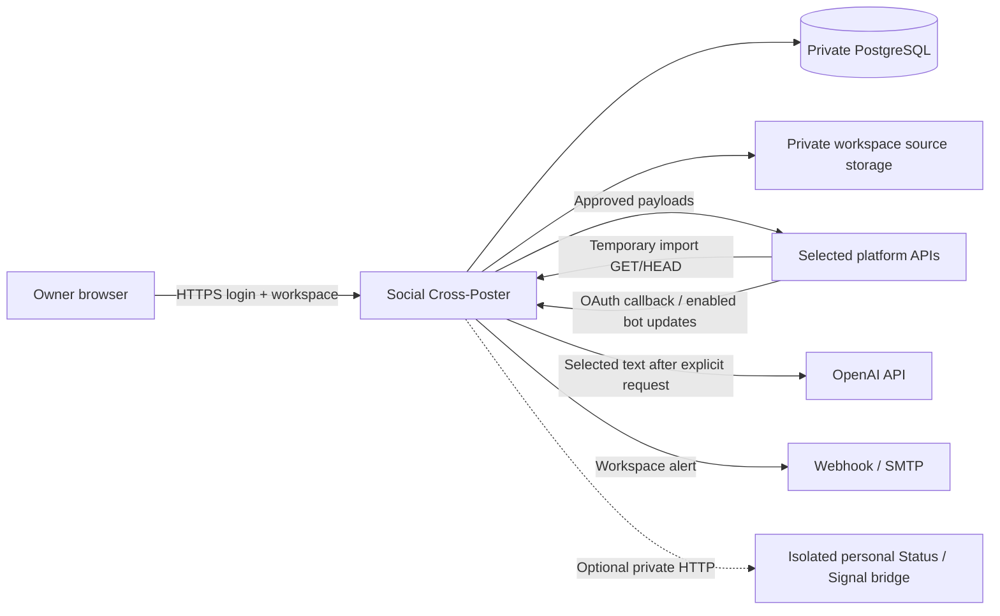

# 3. Context and scope

## System context

## Interfaces and boundaries

| Interface | Direction relative to app | Contract |
|---|---|---|
| Browser | Inbound HTTPS | Owner authentication, CSRF on mutations, explicit workspace |
| Provider authorization/callback | Outbound authorization; inbound callback | Registered fixed callback, one-time state bound to owner/session/workspace, PKCE where supported |
| Temporary provider image import | Inbound HTTPS, only when required | Revocable grant for exact approved source; platform stores the published image |
| Telegram update webhook, if enabled | Inbound HTTPS | Per-connection secret, stored workspace route, update deduplication |
| Platform posting/upload/reconciliation | Outbound HTTPS | Explicit connection/destination, bounded calls, persisted stages |
| OpenAI content assistance | Outbound HTTPS | Optional selected workspace text only; no social secrets or publishing tools |
| Webhook/SMTP notification | Outbound | Workspace recipients, sanitized payload, SSRF controls, durable retries |
| Optional bridges | Private network | Workspace/session isolation; exact operation feasibility required |
| PostgreSQL/media | Private network/filesystem | Workspace constraints/paths, consistent backup inventory |

## Scope

Core scope is editorial preparation, reviewed workspace-local publication, independent one-time schedules/copies, platform-hosted images, recovery, and multiple account sets for one owner per installation. The [catalog](../platforms/README.md) defines current candidates. WhatsApp Business, feeds/DM inboxes/analytics, shared-user installations, cross-workspace campaigns, automatic repeats, permanent public image hosting, video workflows, and autonomous AI publishing are outside scope. No inference is made from the GitHub repository URL about a production hostname.
