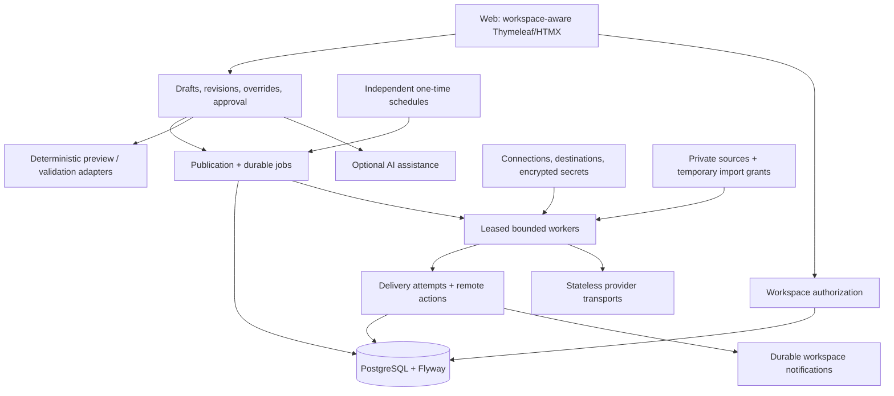

# 5. Building block view

## Application modules

## Responsibilities and contracts

| Module | Responsibility |
|---|---|
| `workspace` | Resolve/authorize explicit tenancy, defaults, archive/export; local post duplication; no silent workspace fallback |
| `web` | Login, workspace picker, composer/AI diff, final confirmation, history/settings; escaped output and CSRF |
| `accounts` | Connections versus selectable destinations, identity verification, refresh locks, health and secret access |
| `contacts` | Local contacts/handles, autocomplete and mention resolution without cross-tenant queries |
| `content` | Versioned drafts, media references, layered overrides, immutable approvals; optimistic conflicts |
| `ai` | Provider abstraction, Responses integration, prompt templates, base revisions, reservations/usage, accepted suggestions |
| `platform` | Capability discovery, adapters and transport; no mutable current-account/token state |
| `publishing` | Atomic submission/jobs, bounded execution, persisted stages, idempotency and reconciliation, aggregation |
| `scheduling` | One-time approved payload/time, timezone/DST/lateness policy, unique schedule publication and cancellation races |
| `media` | Byte/decode validation, immutable derivatives, authorized thumbnails, platform upload/import and temporary grants, dependency-aware cleanup |
| `notify` | Transactional events, workspace recipient resolution, deduplication and bounded delivery |
| `persistence` | Composite tenant foreign keys, unique keys, Flyway, leased job claims and fenced result writes |

[ADR-004](../adr/ADR-004-domain-model-and-feature-scope.md) defines the entity model. Network calls never hold scheduler DB row locks. AI has no dependency that grants it publication authority or access to social secrets. Each job/callback resolves its persisted workspace rather than browser/thread-global state.
