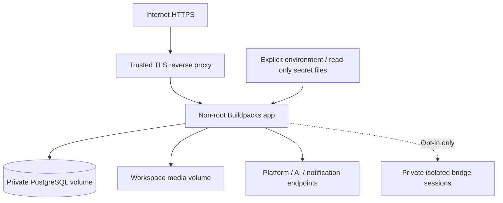

# 7. Deployment view

Source: [patbaumgartner/social-cross-poster](https://github.com/patbaumgartner/social-cross-poster). Planned registry path: `ghcr.io/patbaumgartner/social-cross-poster`. No released image/Compose stack is claimed.

## Build and release

- Follow the [latest-stable baseline](../technologies.md). Use Maven Wrapper and Spring Boot's Buildpacks image goal with a current compatible Paketo builder/run image.
- Set the required Java major explicitly; inspect vendor/patch from SBOM. Buildpacks' defaults are not the version policy.
- Build and smoke-test one image per architecture, preferably on native amd64/arm64 runners; combine tested digests into an OCI index.
- Pin builder/buildpack/run-image inputs and application release digests; refresh through tested update PRs. No default application Dockerfile.
- Run migration, PostgreSQL integration, adapter contracts, tenant isolation, and restart-recovery checks before promotion.

## Runtime topology

Publish the app port only to loopback/private proxy networking. DB and management ports stay private. Builder images are CI dependencies, not production services; production does not need a Docker daemon.

## Persistence and operations

DB, media, config, encryption/signing keys, and optional session volumes have different backup roles. Use the [maintenance backup and isolated restore procedure](../operations/README.md). A restored clone must have dispatch disabled to prevent duplicate publications.

Resource budgets are measurements to establish, including buildpack memory calculation, JVM RSS, DB, images, and queue concurrency. Migrations and upgrades use maintenance windows; no HA, stateless-media, or zero-downtime promise. Native architecture/library compatibility and NAS runtime constraints must be recorded.
